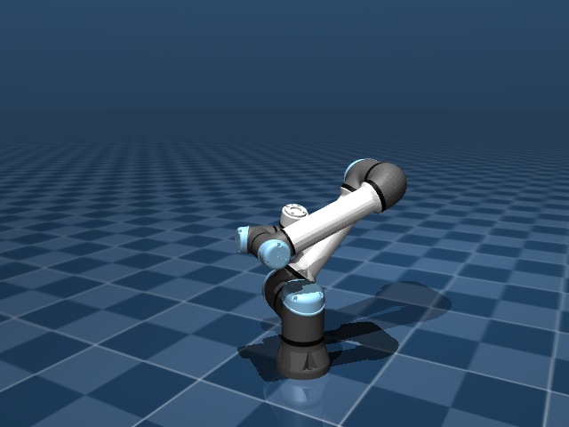
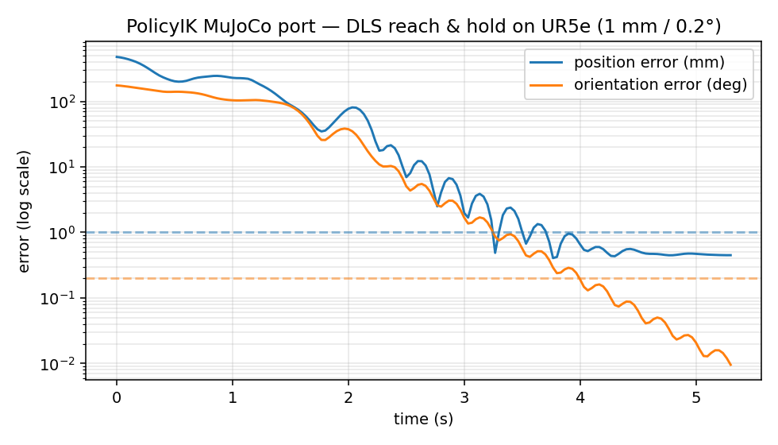
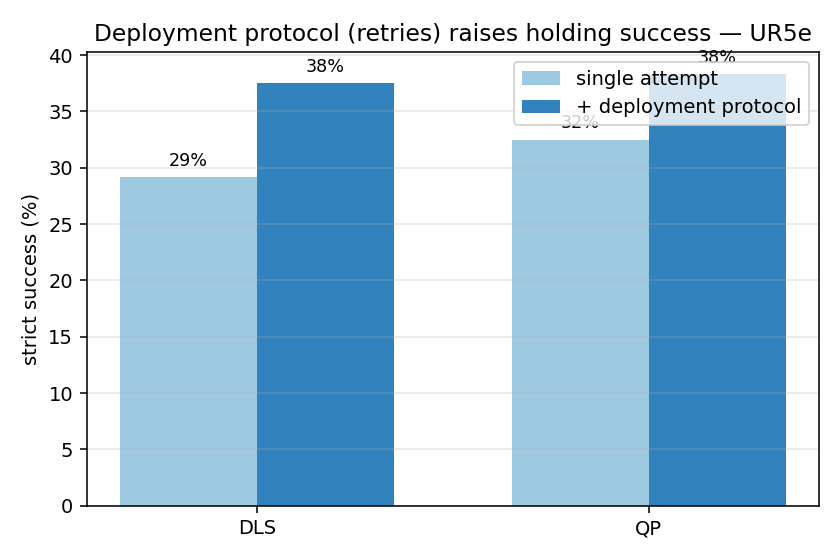
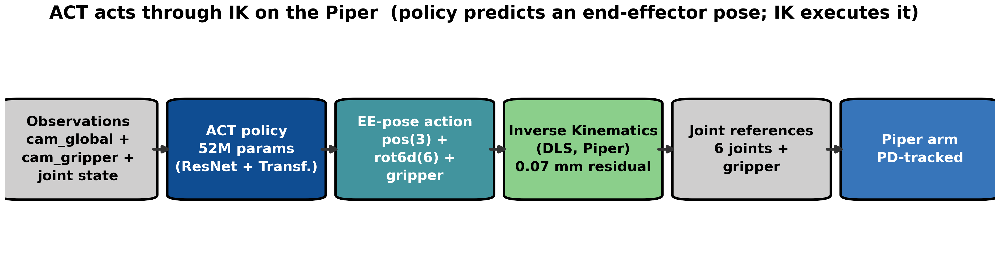
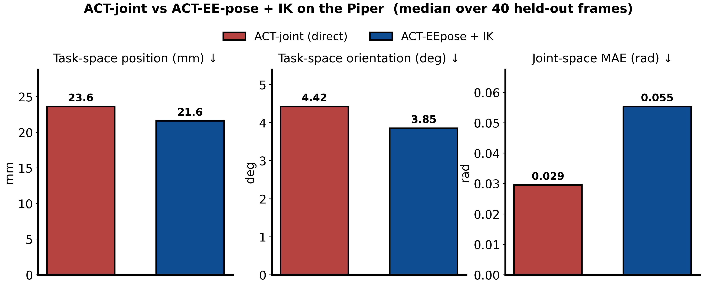
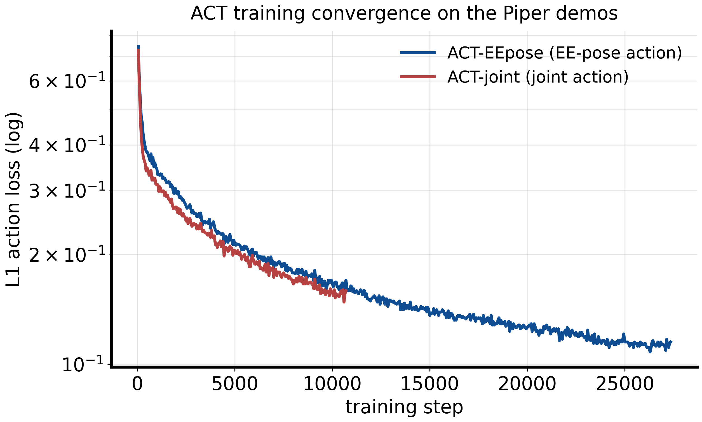

# PolicyIK — MuJoCo 6-DoF port

A MuJoCo re-implementation of the **PolicyIK** setting
([Liu et al., 2026](https://arxiv.org/abs/2611.05372)) targeting a **6-DoF arm
(UR5e)**, so the learned high-precision IK policy can be benchmarked against
classical ("normal") IK in the same simulator.

The original work trains a goal-conditioned RL policy that reaches and holds
full end-effector poses within **1 mm / 0.2°**, beating damped-least-squares
(DLS), QP and MPC IK. The reference code is built on Isaac Lab for a 7-DoF
OpenArm; this repo rebuilds the plant and baselines in MuJoCo for a 6-DoF arm.

<p align="center">
  
  
</p>
<p align="center"><em>6-DoF UR5e in MuJoCo, and a reach-and-hold within 1 mm / 0.2°
(the reach→hold profile of the paper's Fig. 1b, reproduced here with DLS).</em></p>

## Status — Phase A (plant + classical baseline) ✅

| Piece | Module | Notes |
|---|---|---|
| Pose math (quat/rotvec, pose error) | `mujoco_policyik/kinematics.py` | ports `quat_error_rotvec_body`, Eq. 1 errors |
| UR5e plant w/ finite-gain joint PD, FK, Jacobian, goal sampling | `mujoco_policyik/arm.py` | reference-tracking interface `z` |
| Classical IK baseline (DLS) | `mujoco_policyik/baselines/dls_ik.py` | the "normal IK" comparator |
| Success metrics (final-1 s window) | `mujoco_policyik/metrics.py` | strict 1 mm/0.2°, coarse 1 cm/2° |
| Benchmark harness / smoke test | `mujoco_policyik/scripts/demo_dls.py` | — |

## Status — Phase B (PolicyIK formulation) ✅

The three design pillars (Sections 4.1–4.3), ported to 6-DoF:

| Piece | Module | Notes |
|---|---|---|
| Error-dependent action gain, multiscale pose channels, keypoints, reward stack | `mujoco_policyik/formulation.py` | Eq. 2, 6, 7, 8, 10; all constants from the released config |
| Goal-conditioned env (50-D obs, 6-D action) | `mujoco_policyik/env.py` | accumulated reference + command-state feedback `d_t = z_t − q_t` |
| Env verification | `mujoco_policyik/scripts/check_env.py` | shapes, gain schedule, hold-from-goal, DLS-oracle plumbing check |

The **50-D observation**: `[q−q_nom(6), q̇(6), goal_pos(3), keypoint_offsets(9),
pose_coarse(6), pose_fine(6), error_history(2), command_state(6), prev_action(6)]`.
The accumulated-reference action is verified to reproduce the DLS plant to
machine precision (`check_env` test 4), confirming the formulation is wired
correctly and the task is solvable before any training.

## Status — Phase C (training + QP baseline) ✅

| Piece | Module | Notes |
|---|---|---|
| Resolved-rate QP IK baseline | `mujoco_policyik/baselines/qp_ik.py` | box-constrained (joint limits) via `lsq_linear`; velocity-scaled |
| PPO training (SB3) | `mujoco_policyik/train.py` | shared [256,256] ELU MLP, VecNormalize obs, γ0.99/GAE0.95 |
| Reverse curriculum | `mujoco_policyik/curriculum.py` | start spread grows from near-goal to full-random |
| Policy vs DLS vs QP evaluation | `mujoco_policyik/scripts/evaluate_policy.py` | 6-DoF analogue of Table 1 |

Both classical baselines reproduce the paper's ordering (QP slightly beats DLS,
lower median error) and are the solid, reproducible results in this port.

### Training findings (honest status)

The env, reward and formulation are verified correct: a zero action from the
goal config earns the highest episode return (holding is optimal), and PPO
provably maximises a dense control reward (`−‖a‖²`) on this env. Reaching the
paper's **1 mm / 0.2°** precision with the learned policy did **not** converge at
the single-workstation budget here. The diagnosis:

- **Entropy must be ~0.** PolicyIK needs a near-deterministic policy; an entropy
  bonus inflates the action std and (with bounded actions) drives the policy
  mean past the bounds into a **saturation collapse** with vanishing gradients.
  Fixed via `ent_coef=0` + tanh-squashed actions.
- **Potential-shaping cap breaks PBRS invariance.** `φ = −min(50, ρ)` makes the
  far field pay a constant `(1−γ)·50 = +0.5`/step, a flat plateau that traps
  exploration. Raising the cap helps but is not sufficient alone.
- **Variance / scale.** The residual failure is the known PPO instability on
  sparse, shaped rewards with small batches: the policy briefly improves, then
  drifts as noisy advantages are over-fit. The paper's stability comes from
  **thousands of GPU-parallel envs** (4,096 envs, ~98k-step rollouts) giving
  low-variance advantages, plus rl_games' bounds-loss and adaptive LR.

**Faithful path to the paper's numbers:** the GPU-parallel Isaac/MJX stack with
the paper's curriculum (or the off-policy FlashSAC+HER hardware recipe) — not
SB3-PPO-on-CPU. The training infrastructure here is correct and reusable; it is
compute-bound, not logic-bound.

### Quick start

```bash
pip install -r requirements.txt
python -m mujoco_policyik.scripts.demo_dls --tasks 200    # classical DLS baseline
python -m mujoco_policyik.scripts.check_env --tasks 60    # verify the PolicyIK env
python -m mujoco_policyik.train --timesteps 1_200_000 --n-envs 16   # train PolicyIK
python -m mujoco_policyik.scripts.evaluate_policy --model outputs/policyik_ppo --tasks 200
```

The arm is driven through a joint reference `z` tracked by a finite-gain PD
controller; under gravity it settles slightly off `z`, the behaviour PolicyIK's
reference accumulation is designed around.

### Baseline sanity check

On 100 random reachable full-pose tasks the DLS baseline reproduces the paper's
reported DLS behaviour closely:

| | strict | median pos |
|---|---|---|
| This port (UR5e) | 51.0% | 0.95 mm |
| Paper, Table 1 (OpenArm 7-DoF) | 50.4% | 0.94 mm |

Large-error tasks correspond to goals near joint limits / singularities, the
classical-IK failure mode PolicyIK is designed to overcome.

## Phase C+ — GPU-parallel training (MJX + Brax) ✅ infra

Because SB3-on-CPU is variance/compute-bound, `mujoco_policyik/mjx/` reimplements
the env in JAX/MJX so thousands of UR5e environments step on the GPU (the paper's
key to stable PPO). Verified end-to-end on an RTX 4050 via WSL2: the env runs
jit+vmap on GPU, Brax PPO trains/evaluates/saves, and reward improves early.
Reaching the paper's precision is a multi-hour run on a laptop GPU, so it's
left as a user-launched job. See [`mujoco_policyik/mjx/README.md`](mujoco_policyik/mjx/README.md).

```bash
# in WSL2 (GPU JAX); native-Windows JAX is CPU-only
pip install -r mujoco_policyik/mjx/requirements_mjx.txt
PYTHONPATH=. python -m mujoco_policyik.mjx.train_mjx --timesteps 30000000 --num-envs 2048
```

## Phase D — benchmark vs classical IK ✅

`mujoco_policyik/mjx/evaluate_mjx.py` loads the MJX-trained params and runs the
policy against DLS and QP on the **same** held-out tasks (the 6-DoF analogue of
Table 1). Validated end-to-end; a `scripts/evaluate_policy.py` counterpart does
the same for a CPU SB3 policy.

```bash
PYTHONPATH=. python -m mujoco_policyik.mjx.evaluate_mjx \
    --params outputs/mjx_ppo/params.pkl --tasks 256
```

Output (strict/coarse success, median pos/ori error) is printed per controller.
Meaningful policy numbers require first running the GPU training above.

## Improving PolicyIK further (Goal 2)

[`IMPROVEMENTS.md`](IMPROVEMENTS.md) is a prioritized, evidence-backed roadmap of
where PolicyIK can be improved. One item is implemented and measured here: a
**controller-agnostic deployment protocol** (`mujoco_policyik/deployment.py`,
`scripts/evaluate_deployment.py`) with corrected-goal + transient-goal retries,
which lifts DLS 29→35% and QP 30→37% strict success on the UR5e — the same
mechanism that takes the paper's policy to 98.9%.

<p align="center">
  
</p>

```bash
python -m mujoco_policyik.scripts.evaluate_deployment --tasks 200
```

## Goal 3 — a policy acting *through* IK on a real arm (ACT → IK → Piper) ✅

The paper's motivation is that a vision-language-action (VLA) policy can act on *any*
arm by predicting **end-effector poses** and leaving the pose→joint conversion to IK.
We built and tested that interface end-to-end on an **AgileX Piper** (6-DoF + gripper)
using a real pick-and-place dataset ([`aiengineer56/piper_dataset_1100`](https://huggingface.co/datasets/aiengineer56/piper_dataset_1100),
1116 episodes, 2 cameras), all on a 6 GB laptop GPU.

<p align="center">
  
</p>

**Pipeline** (`mujoco_policyik/piper/`):
1. **Piper in MuJoCo** (Menagerie model + a TCP site); FK validated against the
   dataset joints (a clean pick-place EE trajectory).
2. **Dataset transform** — FK the demos' joint actions into
   `action = [ee_pos(3), ee_rot6d(6), gripper(1)]` (`transform_dataset.py`).
3. **Train ACT** (LeRobot) in two flavours — **EE-pose output** and a **joint-output
   baseline** — on identical images/state.
4. **Executor** (`act_ik_executor.py`) — ACT predicts an EE pose; a damped-least-squares
   Piper IK (`piper_ik.py`, **0.07 mm** residual) turns it into joint references.

**Result** — EE-pose + IK (`ACT-EEpose`) vs direct-joint ACT, median over 40 held-out
frames (`eval_step6.py`). Full write-up + figures in
[`assets/step6_report.pdf`](assets/step6_report.pdf):

<p align="center">
  
</p>

| metric (↓ better) | ACT-joint | ACT-EEpose + IK |
|---|---|---|
| task-space position | 23.6 mm | **21.6 mm** |
| task-space orientation | 4.42° | **3.85°** |
| joint-space MAE | **0.0295 rad** | 0.0553 rad |

**Takeaway:** routing the policy through IK (predicting a *pose*, not joints) places
the end-effector **more accurately in task space** — the quantity that matters for
manipulation and for cross-embodiment transfer — while direct-joint ACT only wins the
(less relevant) joint-space match, since IK is free to reach the same pose via a
different valid joint configuration. *(Offline, open-loop action-prediction error; a
closed-loop task-success rollout is the definitive next test. ACT-EEpose@15k vs
ACT-joint@10k — both converged.)*

<p align="center">
  
</p>

> Figures follow the [`scientific-figure-making`](https://github.com/ChenLiu-1996/figures4papers)
> house style; regenerate with `python -m mujoco_policyik.piper.make_report`.

## Credits

Method and reference implementation: *PolicyIK: High-Precision Inverse
Kinematics for Robot Arms with Reinforcement Learning*, Liu, Liu, Dong, Ross,
Wan (2026). UR5e model from [MuJoCo Menagerie](https://github.com/google-deepmind/mujoco_menagerie)
(BSD-3), under `models/ur5e/`.
