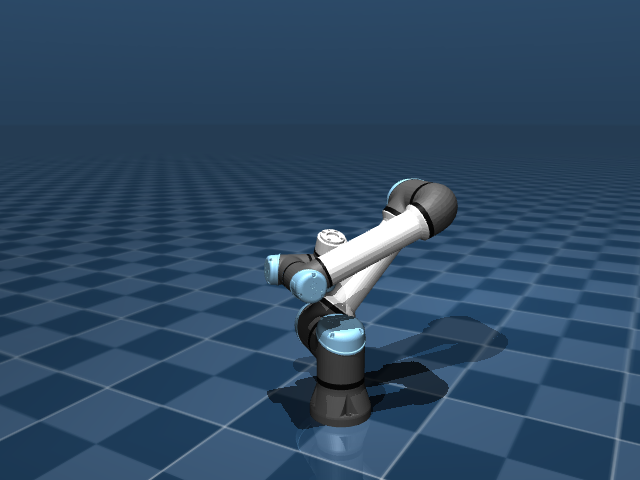
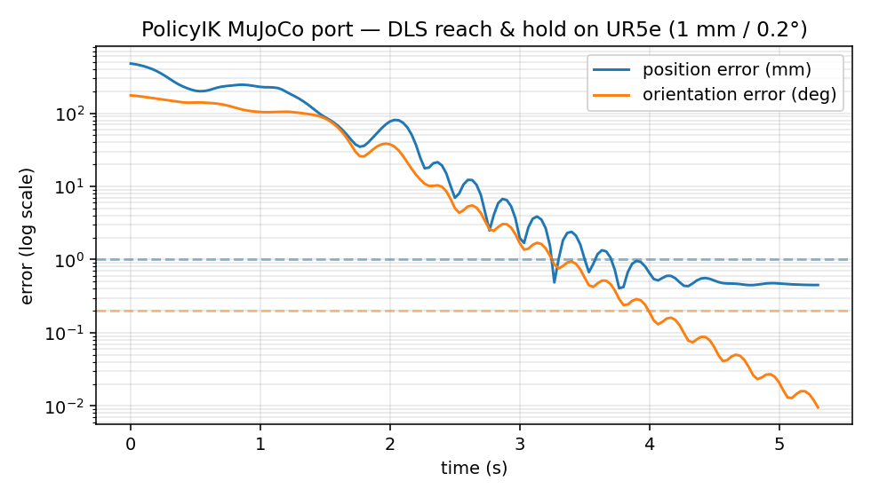
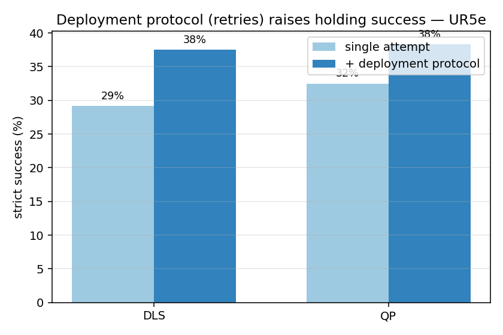

# Draft issue for Tinaliu0123/PolicyIK

**Where to post:** https://github.com/Tinaliu0123/PolicyIK/issues/new
**Suggested labels:** enhancement, help wanted / discussion

---

## Title

Companion MuJoCo port (6‑DoF UR5e, CPU + GPU) — baselines reproduced; interested in a README link / cross‑embodiment collaboration?

## Body

Hi — thanks for a really nice paper and for releasing the code. 👏

To make it easier to build on PolicyIK **without an Isaac Sim / Omniverse setup**, I put together a from‑scratch **MuJoCo port of the formulation on a 6‑DoF arm (UR5e)**:

👉 https://github.com/VatsalyaBhadaurya/PolicyIK

It re‑implements the core of Sections 4.1–4.3 (accumulated joint reference with command‑state feedback `d_t = z_t − q_t`, two‑scale pose channels + error‑dependent gain `β`, and the progress/dwell reward stack) against a finite‑gain joint‑PD UR5e, plus the classical baselines and your deployment protocol. It runs on **CPU (Stable‑Baselines3 PPO)** and **GPU (MJX + Brax PPO)**.

  
  

<em>6‑DoF UR5e in MuJoCo, and a reach‑and‑hold within 1 mm / 0.2° (same reach→hold profile as your Fig. 1b).</em>

### What's working / verified

- **Classical baselines reproduce your Table 1 ordering.** Damped‑least‑squares on the UR5e gives **51.0% strict / 0.95 mm median**, essentially matching your reported DLS (50.4% / 0.94 mm); a resolved‑rate QP slightly beats it, as in the paper.
- **The env matches the plant.** Feeding DLS increments through the accumulated‑reference action reproduces the underlying controller to ~1e‑13 mm on identical tasks — a sanity check that the formulation is wired correctly.
- **Dominant failure mode confirmed.** ~50% of DLS strict failures on the UR5e end with a joint within 2% of a limit (consistent with your 71–81% on the 7‑DoF arm), which is exactly where a learned policy should help.
- **Your deployment protocol ports cleanly** and lifts the classical baselines here too (corrected‑goal + transient‑goal retries):
- **GPU‑parallel training runs end‑to‑end** (MJX + Brax PPO on an RTX 4050 via WSL2): env `jit`+`vmap` on GPU, PPO trains/evaluates/saves.

  

### Honest status

The **training infrastructure is complete and verified**, but converging the learned policy to your **1 mm / 0.2°** precision is **compute‑bound** on my hardware (a 6 GB laptop GPU caps env count) — so the solid, reproducible results in the port today are the **DLS/QP baselines**, not yet a paper‑level learned policy. I didn't want to overstate that.

### Why it might be useful to the project

1. **Lower barrier to entry** — people can try PolicyIK ideas on CPU or a single consumer GPU, no Omniverse needed.
2. **A second embodiment** — a 6‑DoF UR5e alongside your 7‑DoF OpenArm / xArm7, which is a small concrete step toward the **cross‑embodiment** generalization your VLA motivation calls for (one policy conditioned on kinematics across arms).
3. **A clean reference** of the reward/observation design in plain NumPy/JAX that may be handy for others reading the paper.

### A couple of improvement ideas I'd love your take on

- **Learn the error‑dependent gain** instead of per‑robot hand‑tuning (`g_min, d_lo/d_hi, ori_lo/hi`) — a small learned head could remove a tuning burden when moving between arms.
- **Cross‑embodiment conditioning** (URDF/DH embedding + joint masking) so one policy serves multiple arms — the port's second embodiment could be a useful starting point.

### Questions

- Would you be open to a **link to this companion port** from your README (clearly labeled as an unofficial, in‑progress MuJoCo reimplementation)?
- Is **cross‑embodiment** something you're already exploring, or would welcome help on?
- Anything in the formulation you'd want mirrored differently so a MuJoCo version stays faithful to your intent?

Happy to open focused PRs (e.g., tests for the pure‑function metric utilities, or docs) if that's more useful than a link. Thanks again!
